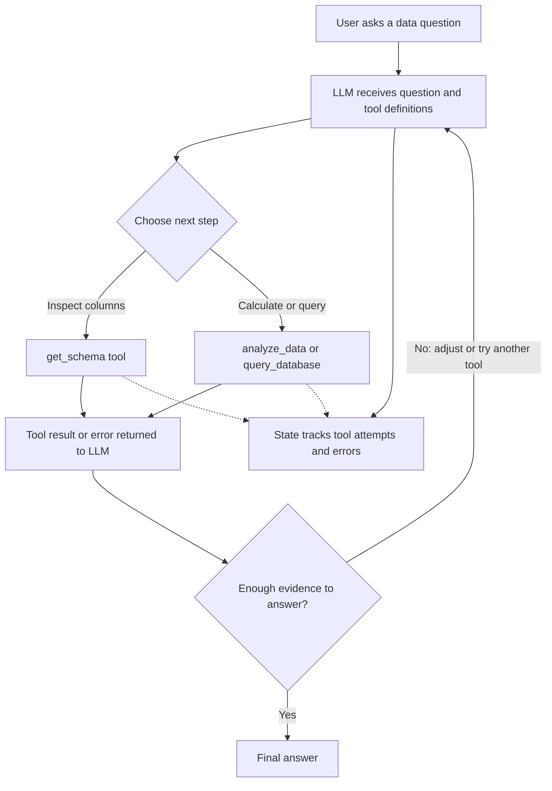

# Data Assistant Agent

**Ask questions about e-commerce sales data in plain English.** This project explores a practical question: how can an LLM use data tools, inspect their results, and revise its next step instead of guessing an answer in one prompt?

I chose a data assistant because the task is easy to understand, but still shows the core parts of an agent: tool selection, execution, observation, state, and a final answer grounded in query results. The focus is on making those steps visible and understandable.

## Architecture and workflow

The agent uses a lightweight **ReAct-style** loop: the model reasons about the next action, acts through a tool, observes the result, and then decides whether to act again or answer. I chose this pattern because data questions often require first inspecting the available columns, then adjusting a query based on what the database returns. A fixed one-shot prompt would hide those steps and make recovery harder to demonstrate.



The CSV is loaded into a local, in-memory SQLite database. The model can call three Python tools:

- **`get_schema`** returns the available column names and types.
- **`query_database`** runs SQL against the `sales` table and returns up to ten result rows.
- **`analyze_data`** calculates basic summaries such as sum, mean, count, and descriptive statistics for a column.

The tool results are added back to the conversation so the model can use observations from earlier steps. Each question gets its own attempt and error log, with a limit of ten tool calls. The terminal prints tool names, inputs, results, errors, and the final answer; this makes the action trail reviewable without relying on a long, hidden chain-of-thought.

## Error handling and scope

SQL errors are returned to the model as observations, allowing it to try a revised query. Tool exceptions are caught and logged, and empty query results are reported explicitly. The attempt limit prevents an unbounded tool loop. A basic guard rejects SQL containing `DROP` or `DELETE`.

This is a first, intentionally focused prototype. The SQL guard is a simple check, not a complete read-only SQL security layer. Query results are truncated to ten rows, so broad questions need aggregation or limits. Metric definitions also matter: for example, a row count is not necessarily a distinct order count. The agent should make that distinction clear in its answer.

## Example run

One run asked: **“How many total orders were placed?”** The agent inspected the schema, queried distinct `Order ID` values, then checked the table row count to distinguish orders from line-item rows.

```text
Distinct orders: 120,378
Rows in table:   128,975

Answer: The database contains 120,378 distinct orders
        across 128,975 rows.
```

The terminal also showed each tool call and its returned result. `main.py` currently runs this and three other example questions; edit its `queries` list to try a different question.

## Setup

1. Download **Amazon Sale Report.csv** from the [Kaggle dataset](https://www.kaggle.com/datasets/thedevastator/unlock-profits-with-e-commerce-sales-data) and place it at `data/Amazon Sale Report.csv`.
2. Install [uv](https://docs.astral.sh/uv/) and use Python 3.14 (the version specified by this project).
3. From the project directory, install dependencies:

   ```bash
   uv sync
   ```

4. Create a `.env` file with your Groq API key:

   ```text
   GROQ_API_KEY=your_groq_api_key
   ```

5. Run the examples:

   ```bash
   uv run python main.py
   ```

The project uses Groq's `openai/gpt-oss-20b` model, pandas to load the CSV, and SQLite for local queries. An API key is required; usage and availability depend on the provider's current terms.

## Project files

- `agent.py` — model interaction and ReAct tool loop
- `tools.py` — tool definitions and local data operations
- `state.py` — per-question tool attempt and error tracking
- `main.py` — example questions and entry point
